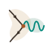
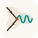
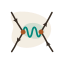

# Lemeit portal, Eureka presentation and identity

Updated 28 October 2026.

| Destination | URL | Source in lemeit/eureka | Cloudflare Pages project |
|---|---|---|---|
| Lemeit project portal | https://lemeit.ar/ | landing/index.html | lemeit-landing, serves landing/ |
| Eureka AI introduction | https://tutor.lemeit.ar/presentacion/ | presentacion/index.html and eureka-motion.js | eureka, serves repository root |
| Direct tutor access | https://tutor.lemeit.ar/ | index.html | eureka |

Lemeit links to Eureka, Aire Escolar and teaching materials, with secondary links to the Physics concept map, weather and water quality. Its original hand-drawn SVG sensor, light bulb and notebook use cream #FAF7F2, oxide orange #9B3D00 and teal #009688. The personal calligraphic L belongs to Luciano Lamaita, not the Lemeit umbrella brand.

## Encuentro: the illustrated Lemeit symbol

Current version selected on **2 November 2026**. It replaces the earlier geometric drawing with the visual language of the project's illustrations: slightly irregular dark outlines, an orange vertex and soft colour washes.

<figure style="text-align:center;margin:2rem auto">
  
  <figcaption><strong>Illustrated Encuentro</strong> · the current Lemeit logo.</figcaption>
</figure>

The symbol borrows lines, arrows and a vertex from **Feynman diagram notation**. In physics those diagrams contribute to interaction calculations; they are not photographs or literal particle trajectories. [Educational reference: ATLAS/CERN](<https://cds.cern.ch/record/2759490/files/Feynman%20Diagrams%20-%20ATLAS%20Cheat%20Sheet.pdf>). In the brand, the encounter is a metaphor for connected ideas, people and projects. No particular physical process is assigned to it.

### Two scales

| Use | Treatment | Resource |
|---|---|---|
| Logo | Transparent background, thin outlines, soft washes | [Logo SVG](../assets/logos/lemeit-encuentro-ilustrado.svg) |
| Favicon | Cream tile and slightly stronger outlines | [Favicon SVG](../assets/logos/lemeit-favicon-ilustrado.svg) |

<figure style="text-align:center;margin:1.5rem auto">
  
  
  
  <figcaption>The same drawing at 16, 32 and 64 pixels.</figcaption>
</figure>

Arrowheads orient automatically along their segments. Logo outlines/wave use 1.5/1.7 units, compared with 2/2.1 for the favicon. The original SVGs do not depend on external fonts. The landing uses a versioned favicon URL; the wiki uses new filenames to refresh caches.

### Palette

Lemeit's cream #FAF7F2, oxide orange #9B3D00 and teal family #009688 remain the base palette. The drawing uses ink #382D24, vertex #A95727, wave #00877B and low-opacity washes #DEC5A6 / #9BBFB0. These are illustrative shades, not a global theme change.

### Interacción: retained illustrated alternative

<figure style="text-align:center;margin:1.5rem auto">
  
  <figcaption><strong>Illustrated Interacción</strong> · an alternative for future uses.</figcaption>
</figure>

It retains two vertices and four arrows without replacing Encuentro. [Download illustrated Interacción](../assets/logos/lemeit-interaccion-ilustrado.svg).

The earlier [geometric Encuentro](../assets/logos/archivo/lemeit-geometrico.svg) and [geometric Interacción](../assets/logos/archivo/lemeit-interaccion-geometrico.svg) remain archived, not active brand assets.

Luciano Lamaita's **calligraphic L** still represents the [Profe teaching portal](../profe-lemeit/index.md), and is not changed by this update.

## Eureka: final composition

The introduction retains EUREKA with AI in superscript and “ancora imparo — aún aprendo”. Four fixed areas surround the central explanation and tutor button: tesseract and mass–spring at left, Lorenz and pendulum at right. Each model moves within its own area; panels do not drift or rotate. Small screens show the introduction first, then a two-column model grid.

A pause control stops the motion. Reduced-motion preferences are respected, and evolution stops while the tab is hidden. Small equations, orange markers, trails and state readings accompany each model, without a calculation table or scene selectors.

These are illustrative mathematical models, not measured data: projected 4D hypercube rotations; Lorenz with σ=10, ρ=28, β=8/3 and RK4 integration; ideal frictionless mass–spring x=A cos(ωt); and the ideal nonlinear pendulum θ̈+(g/L)sinθ=0, integrated with RK4 without the small-angle approximation. Unverified scientist quotations were not restored.

## Favicon and retained alternative

**Encuentro** is selected as the Lemeit favicon, at landing/favicon.svg. Thin orange segments meet a teal wave on cream. Arrowheads use automatically oriented SVG markers, enlarged relative to the line. The HTML declares a versioned icon URL to refresh caches.

**Interacción** remains in docs/identidad-lemeit/favicon-interaccion.svg in the private Eureka repository for future use. Its four arrows were corrected too. These are original brand symbols inspired by Feynman diagram notation; no specific physical process is assigned to them. Other project favicons remain unchanged.

## Publishing and verification

Both Lemeit and Eureka use Git-connected Pages projects. Merging main triggers their deployments. Teaching materials are maintained independently in lemeit/aboutme. Environmental apps stay at https://app.lemeit.ar/aq/, /emas/ and /wq/; no environmental data, APIs or app logic changed.

JavaScript syntax, SVG parsing and links were checked, along with desktop scenes and icon previews at 16, 32 and 64 pixels. Exhaustive mobile visual review remains pending. Local 127.0.0.1 previews require a running local server; published Cloudflare sites do not.

Earlier floating and relocating panel experiments are not the final published layout.

## Scroll-based project tour

Updated 12 November 2026. The landing page presents five projects: Aire Escolar, Eureka, teaching materials, TeX and ΣIM. Illustrations follow an outer circuit with an open centre and separate labels. On mobile, project names remain visible and small captions are hidden.

The stable chapter anchors are `#aire-escolar`, `#eureka`, `#materiales`, `#tex` and `#sim`. Each chapter provides a larger drawing, description and entry link; ΣIM also links to examples and documentation. Its hand-drawn process illustration is not a calculated flowsheet.

Sources are `landing/index.html`, `landing/lemeit-scroll.js` and `landing/sim-croquis.svg` in `lemeit/eureka`. Scrolling is native; IntersectionObserver reveals chapters, reduced motion is respected and content stays readable without JavaScript. Keep IDs stable when adding projects.
