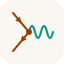
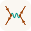

# Portal Lemeit, presentación de Eureka e identidad

Actualizado el 28/10/2026.

| Destino | Dirección | Fuente | Proyecto Cloudflare Pages |
|---|---|---|---|
| Portal de proyectos Lemeit | https://lemeit.ar/ | `landing/index.html` | `lemeit-landing`, publica `landing/` |
| Presentación de Eureka AI | https://tutor.lemeit.ar/presentacion/ | `presentacion/index.html` y `eureka-motion.js` | `eureka`, publica la raíz del repositorio |
| Tutor, acceso directo | https://tutor.lemeit.ar/ | `index.html` | `eureka` |
| Materiales y conceptos | https://profe.lemeit.ar/ | Repositorio independiente `lemeit/aboutme` | `aboutme` |

Lemeit es la entrada común a Eureka, Aire Escolar y materiales de clase, con accesos secundarios a conceptos, meteorología y agua. La portada usa dibujos SVG propios de sensor, lámpara y cuaderno, con conexiones animadas y reducción de movimiento. La L caligráfica personal de Luciano no forma parte de la marca Lemeit.

La presentación conserva **EUREKA con AI en superíndice** y **ancora imparo — aún aprendo**. Dos escenas a cada lado rodean el contenido central: teseracto y masa-resorte a la izquierda; Lorenz y péndulo a la derecha. Las áreas son fijas; se mueve cada modelo, sin desplazar ni rotar los paneles. En pantallas pequeñas, primero aparece la presentación y luego una cuadrícula de dos columnas. No hay selectores de escena ni tabla de cálculo. Un control pausa/reanuda el movimiento; se respeta `prefers-reduced-motion` y se suspende la evolución al ocultar la pestaña.

Son modelos ilustrativos, no datos experimentales: proyección de un hipercubo 4D con rotaciones; Lorenz con σ=10, ρ=28 y β=8/3, integrado con RK4; oscilador ideal x=A cos(ωt), sin rozamiento; péndulo ideal no lineal θ̈+(g/L)sinθ=0, integrado con RK4, sin aproximar sinθ por θ. Los puntos, estelas y lecturas pequeñas muestran el estado calculado. Las ecuaciones son texto de la presentación y no usan la API del tutor. No se reincorporaron citas de científicos sin verificar fuentes.

### Favicon y respaldo

**Encuentro** es el favicon elegido en `landing/favicon.svg`: dos segmentos naranja óxido, vértice central y línea ondulada verde azulado. Las flechas son marcadores SVG orientados con `orient="auto"`, ampliados para distinguirse del trazo. La URL incluye una versión para renovar la caché. Colores: crema `#FAF7F2`, naranja `#9B3D00`, verde `#009688`.

**Interacción** queda reservado en `docs/identidad-lemeit/favicon-interaccion.svg` del repositorio privado Eureka, con las cuatro flechas corregidas y del mismo tamaño. Son símbolos propios inspirados en el lenguaje de Feynman, sin asignarles un proceso físico concreto. No se reemplazan los favicons particulares del tutor ni de los portales ambientales.

### Mantenimiento y verificación

Editar las fuentes, trabajar en una rama y revisar mediante PR. La fusión a `main` dispara los despliegues Git de ambos proyectos Pages. No publicar carpetas de prueba, variantes históricas HTML ni etiquetas locales. Se validaron sintaxis JavaScript, SVG y enlaces, y se revisaron las escenas en escritorio y los favicons ampliados y a 16/32/64 px. La revisión visual exhaustiva en móvil sigue pendiente. Las pruebas locales en `127.0.0.1` requieren un servidor activo; los sitios publicados en Cloudflare no dependen de esa computadora.

## Encuentro: el símbolo de Lemeit

<figure style="text-align:center;margin:2rem auto">
  
  <figcaption><strong>Encuentro</strong> · símbolo elegido para Lemeit y su favicon.</figcaption>
</figure>

El logo toma su lenguaje visual de los **diagramas de Feynman**: líneas, flechas y un vértice de interacción. En física, estos diagramas representan contribuciones a un cálculo de interacción; no son fotografías ni trayectorias literales de partículas. Por ejemplo, las líneas rectas con flechas se usan para fermiones y las onduladas para fotones y ciertos otros bosones. [Referencia didáctica: ATLAS/CERN, Feynman Diagrams](<https://cds.cern.ch/record/2759490/files/Feynman%20Diagrams%20-%20ATLAS%20Cheat%20Sheet.pdf>).

En **Lemeit**, esa estructura se usa como una **metáfora de encuentro entre ideas**. No se le asigna una reacción ni un proceso físico específico: el símbolo reúne ciencias, educación y ambiente sin convertir el logo en una afirmación experimental.

| Elemento del diseño | Lectura de marca |
|---|---|
| Segmentos rectos con flechas | Recorridos que llegan al encuentro y continúan desde él |
| Vértice naranja | Punto común entre preguntas, personas y proyectos |
| Línea ondulada verde | Una conexión que abre otra posibilidad |
| Trazo fino y forma simple | Legibilidad como favicon y coherencia con los dibujos de la portada |

### Colores y construcción

- **Crema cálido `#FAF7F2`**: fondo.
- **Naranja óxido `#9B3D00`**: segmentos, flechas y vértice.
- **Verde azulado `#009688`**: línea ondulada.

Es un SVG propio, con geometría vectorial y sin dependencia de fuentes tipográficas. Las puntas de flecha se alinean automáticamente con sus segmentos y tienen un tamaño mayor que el ancho del trazo. [Abrir o descargar Encuentro en SVG](../assets/logos/lemeit.svg).

### Interacción: alternativa conservada

<figure style="text-align:center;margin:1.5rem auto">
  
  <figcaption><strong>Interacción</strong> · alternativa reservada para futuros usos.</figcaption>
</figure>

Esta variante conserva dos vértices unidos por una onda. Sus flechas también fueron corregidas y ampliadas. Queda respaldada, pero **no reemplaza a Encuentro** como favicon elegido. [Abrir o descargar Interacción en SVG](../assets/logos/lemeit-interaccion.svg).

La **L caligráfica** identifica personalmente a **Luciano Lamaita** y representa al portal **Profe Lamaita**; no es el logo de Lemeit. [Ver la ficha del portal docente](../profe-lemeit/index.md).

## Registro de decisiones

- Lemeit deja de ser una portada exclusiva del tutor y reúne los proyectos mediante ilustraciones originales de trazo manual.
- Se mantiene la paleta propia; la L personal se retira de la portada de marca.
- Eureka recupera teseracto, Lorenz, ecuaciones, AI en superíndice y el lema; luego incorpora resorte y péndulo.
- La composición final divide la pantalla en cuatro áreas estables alrededor del contenido central. Los ensayos con paneles flotantes y cambios de posición no son el diseño final.
- Se elige Encuentro como favicon y se corrigen tamaño y orientación de las flechas de ambas variantes. Interacción queda respaldado para usos futuros.

## Alcance sobre los otros proyectos

Aire Escolar sigue en [app.lemeit.ar/aq/](https://app.lemeit.ar/aq/), meteorología en [app.lemeit.ar/emas/](https://app.lemeit.ar/emas/) y agua en [app.lemeit.ar/wq/](https://app.lemeit.ar/wq/). Se agregaron accesos desde Lemeit; no se modificaron sensores, bases de datos, APIs ni aplicaciones ambientales. Los materiales y el mapa de Física siguen en sus rutas de Profe Lamaita.

## Recorrido de portada al desplazarse

La portada usa «Ciencias · Educación · Ambiente» y elimina el menú superior. El dibujo inicial es un índice visual: sensor → Aire Escolar, lámpara → Eureka, cuaderno → materiales. Cada símbolo lleva por scroll a su capítulo, con dibujo ampliado, descripción breve y enlace al sitio correspondiente. Los capítulos aparecen en ese orden, uno por pantalla como mínimo; las ilustraciones se revelan junto al texto al bajar. Se conserva el desplazamiento nativo y se oculta solo la barra visual.

La implementación está en `landing/index.html` y `landing/lemeit-scroll.js` de Eureka. IntersectionObserver activa las apariciones, y las anclas `#aire-escolar`, `#eureka` y `#materiales` permiten accesos directos. Con reducción de movimiento o sin JavaScript el contenido permanece legible. Para sumar proyectos, agregar el capítulo, su dibujo y el acceso en el índice visual, manteniendo IDs estables.
