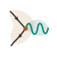
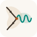
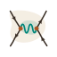

# Portal Lemeit, presentación de Eureka e identidad

Actualizado el 28/10/2026.

| Destino | Dirección | Fuente | Proyecto Cloudflare Pages |
|---|---|---|---|
| Portal de proyectos Lemeit | https://lemeit.ar/ | `landing/index.html` | `lemeit-landing`, publica `landing/` |
| Presentación de Eureka AI | https://tutor.lemeit.ar/presentacion/ | `presentacion/index.html` y `eureka-motion.js` | `eureka`, publica la raíz del repositorio |
| Tutor, acceso directo | https://tutor.lemeit.ar/ | `index.html` | `eureka` |
| Materiales y conceptos | https://profe.lemeit.ar/ | Repositorio independiente `lemeit/aboutme` | `aboutme` |

Lemeit es la entrada común a Eureka, Aire Escolar y materiales de clase, con accesos secundarios a conceptos, meteorología y agua. La portada usa dibujos SVG propios de sensor, lámpara y cuaderno, con conexiones animadas y reducción de movimiento. La L caligráfica personal de Luciano no forma parte de la marca Lemeit.

La presentación conserva **EUREKA con AI en superíndice** y **ancora imparo — aún aprendo**. Dos escenas a cada lado rodean el contenido central: teseracto y masa-resorte a la izquierda; Lorenz y péndulo a la derecha. Las áreas son fijas; se mueve cada modelo, sin desplazar ni rotar los paneles. En pantallas pequeñas, primero aparece la presentación y luego una cuadrícula de dos columnas. No hay selectores de escena ni tabla de cálculo. Un control pausa/reanuda el movimiento; se respeta `prefers-reduced-motion` y se suspende la evolución al ocultar la pestaña.

Son modelos ilustrativos, no datos experimentales: proyección de un hipercubo 4D con rotaciones; Lorenz con σ=10, ρ=28 y β=8/3, integrado con RK4; oscilador ideal x=A cos(ωt), sin rozamiento; péndulo ideal no lineal θ̈+(g/L)sinθ=0, integrado con RK4, sin aproximar sinθ por θ. Los puntos, estelas y lecturas pequeñas muestran el estado calculado. Las ecuaciones son texto de la presentación y no usan la API del tutor. No se reincorporaron citas de científicos sin verificar fuentes.

### Favicon y respaldo

**Encuentro ilustrado** es el favicon elegido en `landing/favicon.svg`: contornos oscuros, vértice naranja y onda verde sobre manchas suaves de color. Las flechas son marcadores SVG orientados con `orient="auto"`, ampliados para distinguirse del trazo. La URL incluye una versión para renovar la caché. Colores: crema `#FAF7F2`, naranja `#9B3D00`, verde `#009688`.

**Interacción** queda reservado en `docs/identidad-lemeit/favicon-interaccion.svg` del repositorio privado Eureka, con las cuatro flechas corregidas y del mismo tamaño. Son símbolos propios inspirados en el lenguaje de Feynman, sin asignarles un proceso físico concreto. No se reemplazan los favicons particulares del tutor ni de los portales ambientales.

### Mantenimiento y verificación

Editar las fuentes, trabajar en una rama y revisar mediante PR. La fusión a `main` dispara los despliegues Git de ambos proyectos Pages. No publicar carpetas de prueba, variantes históricas HTML ni etiquetas locales. Se validaron sintaxis JavaScript, SVG y enlaces, y se revisaron las escenas en escritorio y los favicons ampliados y a 16/32/64 px. La revisión visual exhaustiva en móvil sigue pendiente. Las pruebas locales en `127.0.0.1` requieren un servidor activo; los sitios publicados en Cloudflare no dependen de esa computadora.

## Encuentro: el símbolo ilustrado de Lemeit

Versión vigente desde el **02/11/2026**. Reemplaza al dibujo geométrico anterior con el mismo lenguaje de las ilustraciones de los proyectos: contornos oscuros ligeramente irregulares, vértice naranja y manchas suaves de color.

<figure style="text-align:center;margin:2rem auto">
  
  <figcaption><strong>Encuentro ilustrado</strong> · logo vigente de Lemeit.</figcaption>
</figure>

El logo toma su lenguaje visual de los **diagramas de Feynman**: líneas, flechas y un vértice de interacción. En física, representan contribuciones a un cálculo de interacción, no fotografías ni trayectorias literales. Las líneas con flechas y las onduladas se usan para distinguir tipos de partículas. [Referencia didáctica: ATLAS/CERN, Feynman Diagrams](<https://cds.cern.ch/record/2759490/files/Feynman%20Diagrams%20-%20ATLAS%20Cheat%20Sheet.pdf>).

En Lemeit, el encuentro de líneas es una metáfora de ideas, personas y proyectos que se conectan. **No se le asigna un proceso físico concreto.**

### Logo y favicon: dos escalas

| Uso | Tratamiento | Recurso |
|---|---|---|
| Logo | Fondo transparente, contornos finos y manchas suaves | [Descargar SVG del logo](../assets/logos/lemeit-encuentro-ilustrado.svg) |
| Favicon | Fondo crema y contornos algo reforzados | [Descargar SVG del favicon](../assets/logos/lemeit-favicon-ilustrado.svg) |

<figure style="text-align:center;margin:1.5rem auto">
  
  
  
  <figcaption>El mismo dibujo a 16, 32 y 64 píxeles.</figcaption>
</figure>

Las puntas se orientan sobre cada segmento. El trazo del logo es de 1,5 unidades y su onda de 1,7; el favicon usa 2 y 2,1. Son SVG propios, sin fuentes externas. La portada renueva la caché con `/favicon.svg?v=ilustrado-20261102`; la wiki usa archivos nuevos para su logo y favicon.

### Colores del dibujo

La base de Lemeit sigue siendo crema `#FAF7F2`, naranja óxido `#9B3D00` y la familia verde azulado `#009688`. La ilustración usa tinta `#382D24`, vértice `#A95727`, onda `#00877B` y manchas `#DEC5A6` / `#9BBFB0` con baja opacidad. Estos matices adaptan el dibujo al estilo de la portada; no cambian la paleta global.

### Interacción ilustrado: alternativa reservada

<figure style="text-align:center;margin:1.5rem auto">
  
  <figcaption><strong>Interacción ilustrado</strong> · alternativa para futuros usos.</figcaption>
</figure>

Se conserva con sus dos vértices y cuatro flechas, pero no reemplaza a Encuentro como símbolo elegido. [Descargar Interacción ilustrado](../assets/logos/lemeit-interaccion-ilustrado.svg).

Las versiones geométricas anteriores permanecen como respaldo: [Encuentro geométrico](../assets/logos/archivo/lemeit-geometrico.svg) e [Interacción geométrico](../assets/logos/archivo/lemeit-interaccion-geometrico.svg). No son los archivos activos de marca.

La **L caligráfica de Luciano Lamaita** representa al [portal Profe](../profe-lemeit/index.md). Esta actualización no modifica esa identidad personal.

## Registro de decisiones

- Lemeit deja de ser una portada exclusiva del tutor y reúne los proyectos mediante ilustraciones originales de trazo manual.
- Se mantiene la paleta propia; la L personal se retira de la portada de marca.
- Eureka recupera teseracto, Lorenz, ecuaciones, AI en superíndice y el lema; luego incorpora resorte y péndulo.
- La composición final divide la pantalla en cuatro áreas estables alrededor del contenido central. Los ensayos con paneles flotantes y cambios de posición no son el diseño final.
- Se elige Encuentro como favicon y se corrigen tamaño y orientación de las flechas de ambas variantes. Interacción queda respaldado para usos futuros.

## Alcance sobre los otros proyectos

Aire Escolar sigue en [app.lemeit.ar/aq/](https://app.lemeit.ar/aq/), meteorología en [app.lemeit.ar/emas/](https://app.lemeit.ar/emas/) y agua en [app.lemeit.ar/wq/](https://app.lemeit.ar/wq/). Se agregaron accesos desde Lemeit; no se modificaron sensores, bases de datos, APIs ni aplicaciones ambientales. Los materiales y el mapa de Física siguen en sus rutas de Profe Lamaita.

## Recorrido de portada al desplazarse

Actualizado el 12/11/2026. La portada utiliza «Ciencias · Educación · Ambiente» y un índice visual de cinco proyectos: Aire Escolar, Eureka, materiales de clase, TeX y ΣIM. Los dibujos se distribuyen sobre un recorrido exterior, con el centro libre y nombres separados de las ilustraciones. En móvil se conservan los nombres y se ocultan las bajadas pequeñas.

Cada símbolo lleva a su capítulo: `#aire-escolar`, `#eureka`, `#materiales`, `#tex` y `#sim`. Allí aparecen la ilustración ampliada, la descripción y el enlace de entrada. ΣIM ofrece también ejemplos y documentación. Su croquis de equipos y corrientes se inspira en la referencia de DWSIM; no representa una simulación calculada.

Las fuentes son `landing/index.html`, `landing/lemeit-scroll.js` y `landing/sim-croquis.svg` en `lemeit/eureka`. IntersectionObserver activa las apariciones. El desplazamiento es nativo y se respeta el movimiento reducido; sin JavaScript el contenido permanece legible. Mantener los IDs y actualizar dibujo, capítulo y lista de destinos al sumar proyectos.
